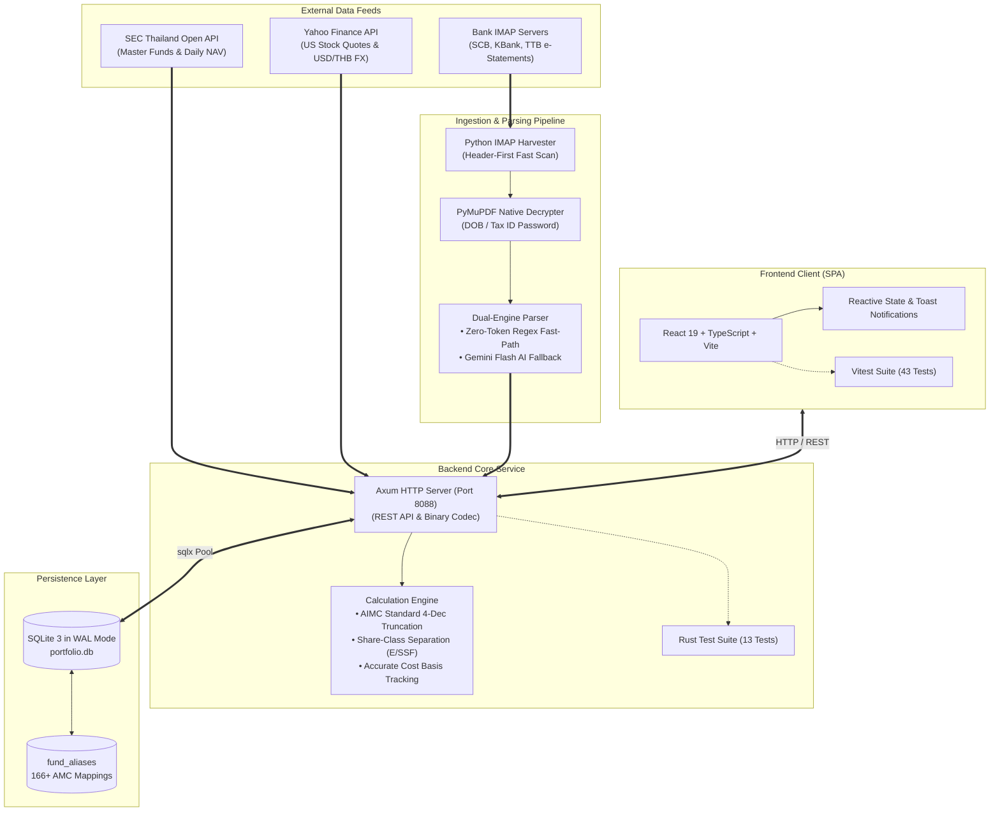

# Fund Portfolio Management System

[](https://github.com/noraseth-swu/fund-portfolio/actions/workflows/ci.yml)
[](LICENSE)
[](https://www.rust-lang.org/)
[](https://react.dev/)

> **Language Versions:** [English](README.md) | [ภาษาไทย](README.th.md)

A self-hosted, precision multi-asset investment portfolio tracker designed for Thai mutual funds (SEC Thailand master data), foreign equities (US stocks via Dime!), and Provident Fund (PVD) holdings.

Built with an offline-first **Rust (Axum)** core, an automated **Python statement harvester** with Gemini AI fallback, and a high-performance **React 19 / TypeScript** dashboard.

---

## Architecture Overview



---

## Core Capabilities

1. **AIMC-Standard Precision Accounting:**
   - Implements Association of Investment Management Companies (AIMC) truncation to 4 decimal places for unitholder allocations (`floor(amount / price * 10000) / 10000`).
   - Prevents rounding drift and reconciles 100% to the fourth decimal place against official bank statements (SCB Easy, K PLUS, Dime!).

2. **Automated Statement Ingestion Pipeline:**
   - Connects to banking email channels over secure IMAP.
   - Automatically decrypts password-protected PDF confirmation notes (birth dates and national IDs).
   - Zero-token regular expression parser for instant extraction, with automatic Google Gemini Flash AI fallback for unstructured formats.

3. **Multi-Asset Unified Tracking:**
   - **Thai Mutual Funds:** SEC Project ID resolution with 166 unitholder class aliases (Retail, E-Class, SSF, RMF).
   - **US Equities:** Direct ingestion from Dime! statements with real-time USD quote conversion and exchange rate tracking.
   - **Provident Funds (PVD):** Periodic portfolio snapshot integration (e.g., KBANK PVD).

4. **Modern High-Contrast Reactive UI:**
   - Single-entry and multi-row batch transaction recording.
   - Interactive calendar with trading-day NAV resolution and highlight markers.
   - Comprehensive privacy mode with financial amount masking while preserving public market quotes.
   - Global toast feedback system and non-blocking state synchronization.

---

## Tech Stack

| Component | Technology | Role |
|---|---|---|
| **Frontend** | React 19, TypeScript, Vite 8, Tailwind CSS | High-performance responsive web client |
| **Frontend Testing** | Vitest, Testing Library, JSDOM | 43 automated unit tests |
| **Backend API** | Rust 1.80+, Axum 0.7, Tokio, Serde, rust_decimal | Core REST services and mathematical valuation engine |
| **Backend Testing** | Cargo test | 13 automated unit tests |
| **Database** | SQLite 3 with WAL Mode, SQLx | ACID transaction storage with 100% parameterized SQL |
| **Automation** | Python 3.12, PyMuPDF, Google Gemini API | Background email harvester and PDF statement parser |
| **External APIs** | SEC Thailand Open API, Yahoo Finance | Master fund profiles, historical NAVs, and FX rates |
| **CI/CD** | GitHub Actions | Automated build, test, and quality gate on every commit |

---

## Quickstart

### Prerequisites
- [Rust](https://www.rust-lang.org/) (version 1.80 or later)
- [Node.js](https://nodejs.org/) (version 22 or later)
- [Python](https://www.python.org/) (version 3.10 or later)

### 1. Backend Setup
```bash
cd backend
cp .env.example .env   # Configure GEMINI_API_KEY and email settings if needed
cargo build
cargo test             # Run 13 unit tests
cargo run              # Starts HTTP server on http://localhost:8088
```

### 2. Frontend Setup
```bash
cd frontend
npm ci
npm test -- --run      # Run 43 Vitest tests
npm run build          # Verify production bundle
npm run dev            # Starts client on http://localhost:5173
```

### 3. Automated Statement Harvester (Optional)
```bash
cd backend
python -m venv venv
# Windows:
.\venv\Scripts\activate
# Linux/macOS:
source venv/bin/activate

pip install -r requirements.txt
python scripts/email_harvester.py --once
```

---

## Automated Testing & Quality Gates

The project maintains comprehensive test coverage across both frontend and backend layers:

- **Backend:** 13 unit tests verifying share class separation, AIMC truncation, idempotency key generation, and cost basis calculations.
- **Frontend:** 43 unit tests verifying form validation, multi-directional transaction calculation, log formatters, and table interactions.
- **Continuous Integration:** Every commit pushed to GitHub automatically executes `cargo test`, `npm test`, and `npm run build` in GitHub Actions.

---

## Security & Privacy Note

- All database queries use strictly parameterized inputs via SQLx, eliminating SQL injection risks.
- Banking statements are parsed locally or through direct API calls.
- Sensitive environment files (`.env`) and personal database backups are strictly excluded from git tracking via `.gitignore`.

---

## License

This project is licensed under the MIT License: see the [LICENSE](LICENSE) file for details.
