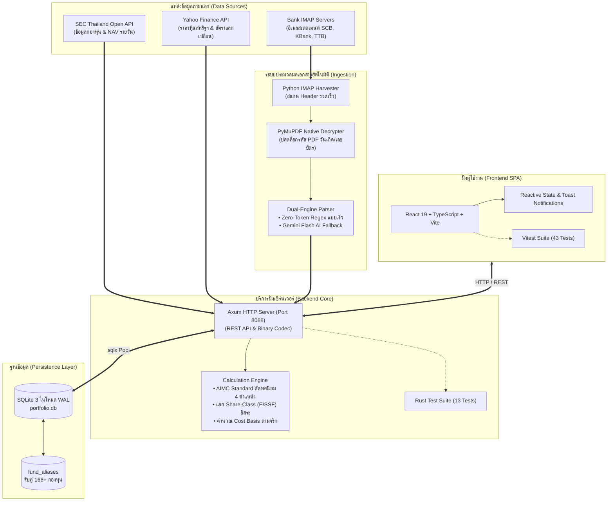

# ระบบบริหารและติดตามพอร์ตการลงทุน (Fund Portfolio Management System)

[](https://github.com/noraseth-swu/fund-portfolio/actions/workflows/ci.yml)
[](LICENSE)
[](https://www.rust-lang.org/)
[](https://react.dev/)

> **ภาษาที่รองรับ:** [English](README.md) | [ภาษาไทย](README.th.md)

ระบบบันทึกและวิเคราะห์พอร์ตการลงทุนส่วนบุคคลแบบ Self-hosted ออกแบบมาเพื่อรองรับสินทรัพย์หลากหลายประเภทของนักลงทุนไทยโดยเฉพาะ: ทั้งกองทุนรวมไทย (เชื่อมต่อข้อมูล ก.ล.ต.), หุ้นต่างประเทศ (หุ้นสหรัฐฯ ผ่าน Dime!), และกองทุนสำรองเลี้ยงชีพ (PVD)

ขับเคลื่อนด้วยแกนกลาง **Rust (Axum)** ประสิทธิภาพสูง, ระบบดึงและถอดรหัสเอกสารธนาคารอัตโนมัติด้วย **Python** ร่วมกับ Gemini Flash AI, และหน้าจอ Dashboard แบบ Reactive ด้วย **React 19 / TypeScript**

---

## สถาปัตยกรรมระบบ (System Architecture)



---

## จุดเด่นและฟังก์ชันการทำงานหลัก

1. **คำนวณตามมาตรฐานสมาคม บลจ. (AIMC Standard):**
   * ใช้การตัดทศนิยม 4 ตำแหน่ง (`truncate4`) ตามเกณฑ์คำนวณหน่วยลงทุนจริงของสถาบันการเงิน (`floor(amount / price * 10000) / 10000`)
   * ป้องกันปัญหาการปัดเศษสะสม และ Reconcile ตรงกับแอปธนาคาร (SCB Easy, K PLUS, Dime!) ระดับทศนิยม 4 ตำแหน่ง 100%

2. **ระบบดึงและแกะสเตตเมนต์ธนาคารอัตโนมัติ:**
   * เชื่อมต่อกล่องจดหมายธนาคารผ่าน IMAP SSL
   * ปลดล็อกรหัสผ่านไฟล์ PDF หนังสือรับรองสิทธิในหน่วยลงทุนอัตโนมัติ (วันเกิด หรือเลขประจำตัวประชาชน)
   * ใช้ Regular Expression แบบ Zero-token เพื่อความรวดเร็วและประหยัดต้นทุน พร้อม Fallback ไปยัง Google Gemini Flash AI สำหรับรูปแบบเอกสารที่มีความซับซ้อน

3. **รวบรวมสินทรัพย์การลงทุนไว้ในที่เดียว (Unified Multi-Asset):**
   * **กองทุนรวมไทย:** เชื่อมโยงรหัสโครงการ ก.ล.ต. (SEC Project ID) พร้อมระบบจับคู่ Share Class (เช่น คลาส E-Class, SSF, RMF) กว่า 166 รายการ
   * **หุ้นสหรัฐฯ:** ดึงรายการซื้อขายจากสเตตเมนต์ Dime! พร้อมแปลงมูลค่าตลาดเป็นเงินบาทแบบ Real-time ตามอัตราแลกเปลี่ยน
   * **กองทุนสำรองเลี้ยงชีพ (PVD):** บันทึก Snapshot มูลค่าและผลตอบแทนของกองทุนสำรองเลี้ยงชีพ (เช่น KBANK PVD)

4. **หน้าจอ Dashboard แบบ Reactive:**
   * บันทึกรายการได้ทั้งแบบรายการเดี่ยว (Single Entry) และแบบตารางหลายรายการพร้อมกัน (Multi-row Batch Entry)
   * ปฏิทินเลือกวันทำรายการที่ไฮไลท์เฉพาะวันทำการที่มีราคา NAV ซื้อขายจริง พร้อมปุ่มดึงราคา NAV อัตโนมัติ
   * โหมดรักษาความเป็นส่วนตัว (Privacy Mode) ซ่อนตัวเลขยอดเงินลงทุนและมูลค่าพอร์ต แต่คงแสดงราคาตลาดปัจจุบันตามมาตรฐาน Financial UI
   * ระบบแจ้งเตือนผลการทำงาน (Toast Notification) และอัปเดตข้อมูลอัตโนมัติทันทีโดยไม่ต้องรีโหลดหน้าเว็บ

---

## เทคโนโลยีที่ใช้งาน (Tech Stack)

| ส่วนประกอบ | เทคโนโลยี | หน้าที่ |
|---|---|---|
| **Frontend** | React 19, TypeScript, Vite 8, Tailwind CSS | เว็บแอปพลิเคชันแบบ Responsive |
| **Frontend Testing** | Vitest, Testing Library, JSDOM | การทดสอบ Unit Test อัตโนมัติ 43 ชุด |
| **Backend API** | Rust 1.80+, Axum 0.7, Tokio, Serde, rust_decimal | REST API และเครื่องคิดเลขคำนวณมูลค่าพอร์ตความแม่นยำสูง |
| **Backend Testing** | Cargo test | การทดสอบ Unit Test ฝั่ง Backend 13 ชุด |
| **Database** | SQLite 3 ในโหมด WAL, SQLx | จัดเก็บข้อมูลธุรกรรม พร้อมป้องกัน SQL Injection 100% ผ่าน Parameterized Query |
| **Automation** | Python 3.12, PyMuPDF, Google Gemini API | ระบบดึงอีเมลและแกะข้อมูลจากสเตตเมนต์ PDF |
| **External APIs** | SEC Thailand Open API, Yahoo Finance | ข้อมูลหลักทรัพย์กองทุนรวม, ราคา NAV ย้อนหลัง, ราคาหุ้น และอัตราแลกเปลี่ยน |
| **CI/CD** | GitHub Actions | ระบบตรวจจับข้อผิดพลาดและทดสอบโค้ดอัตโนมัติทุกครั้งที่ Commit |

---

## ขั้นตอนการติดตั้งและเริ่มต้นใช้งาน (Quickstart)

### ข้อกำหนดเบื้องต้น
- [Rust](https://www.rust-lang.org/) (เวอร์ชัน 1.80 ขึ้นไป)
- [Node.js](https://nodejs.org/) (เวอร์ชัน 22 ขึ้นไป)
- [Python](https://www.python.org/) (เวอร์ชัน 3.10 ขึ้นไป)

### 1. การติดตั้งและรันฝั่ง Backend
```bash
cd backend
cp .env.example .env   # กำหนดค่า GEMINI_API_KEY และข้อมูลอีเมลในไฟล์ .env
cargo build
cargo test             # รันการทดสอบ 13 tests
cargo run              # เริ่มต้นการทำงานที่ http://localhost:8088
```

### 2. การติดตั้งและรันฝั่ง Frontend
```bash
cd frontend
npm ci
npm test -- --run      # รันการทดสอบ Vitest 43 tests
npm run build          # ตรวจสอบการ Build สำหรับ Production
npm run dev            # เริ่มต้นการทำงานที่ http://localhost:5173
```

### 3. การรันระบบดึงสเตตเมนต์อัตโนมัติ (Optional)
```bash
cd backend
python -m venv venv
# สำหรับ Windows:
.\venv\Scripts\activate
# สำหรับ Linux/macOS:
source venv/bin/activate

pip install -r requirements.txt
python scripts/email_harvester.py --once
```

---

## การทดสอบระบบและเกณฑ์ควบคุมคุณภาพ (Automated Testing)

โปรเจกต์นี้มีชุดทดสอบครอบคลุมทั้งส่วน Backend และ Frontend รวม 56 ชุดการทดสอบ:
* **Backend:** 13 ชุดทดสอบ ตรวจสอบความถูกต้องของการแยก Share Class, การตัดทศนิยม AIMC, การคำนวณต้นทุน และ Idempotency Key
* **Frontend:** 43 ชุดทดสอบ ตรวจสอบ Form Validation, เครื่องคิดเลขคำนวณสามทิศทาง, การแปลง Log และการแสดงผลตาราง
* **CI/CD Pipeline:** ทำงานอัตโนมัติบน GitHub Actions เมื่อมีการเปิด Pull Request หรือ Push โค้ดเข้า branch `main`

---

## สัญญาอนุญาต (License)

โปรเจกต์นี้เผยแพร่ภายใต้สัญญาอนุญาตแบบ MIT License: สามารถดูรายละเอียดเพิ่มเติมได้ที่ไฟล์ [LICENSE](LICENSE)
