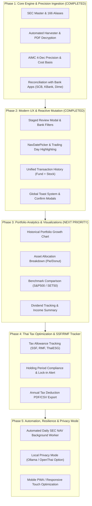

# Fund Portfolio Management System: Updated Engineering Roadmap

**Document Version:** 2.0  
**Updated:** 2026-11-16  
**Status:** Active & Aligned with Slices 1–25  
**Reference Documents:** [tasks/plan.md](file:///d:/git/fund-portfolio/tasks/plan.md), [tasks/todo.md](file:///d:/git/fund-portfolio/tasks/todo.md), [spec.md](file:///d:/git/fund-portfolio/spec.md)

---

## 1. Executive Summary & Impact Analysis of Recent Bug Fixes

ในช่วง Slice 1 ถึง Slice 25 ได้มีการแก้ไขบั๊กเชิงลึกและปรับโครงสร้างสถาปัตยกรรม (Architectural Refactoring) ครั้งใหญ่มากกว่า 50 ประเด็น ซึ่งส่งผลกระทบเชิงบวก (High Positive Impact) ต่อ Roadmap ทั้งระบบ ดังนี้:

### 1.1 การปลดล็อกความแม่นยำของฐานข้อมูล (Data Integrity Unlocked)
- **ปัญหาเดิม:** 
  - หน่วยลงทุนคลาดเคลื่อนจากการปัดเศษทศนิยม (`round` vs `AIMC truncate`)
  - ราคาต้นทุน (Cost Basis) ถูกบวกค่าธรรมเนียม (Fee) ซ้ำซ้อน ทำให้ผลตอบแทน P/L พอร์ตเพี้ยนจากแอปธนาคาร
  - ปัญหาราคา NAV สลับ Share-Class (SSF ชน E-Class) และรายการสลับคอลัมน์ (เช่น SCBS&P500E วันที่ 2025-07-29)
- **Impact ต่อ Roadmap:** 
  - ก่อนหน้านี้ **ไม่สามารถทำฟีเจอร์ Analytics, กราฟผลตอบแทนย้อนหลัง (Performance Charts) หรือ Tax Planning ได้** เพราะตัวเลขต้นทุนและหน่วยลงทุนฐานผิดพลาด
  - ปัจจุบัน พอร์ตได้รับการ Reconcile ตรงกับแอปสถาบันการเงิน (SCB Easy, K PLUS, Dime) **ตรง 100% ระดับทศนิยม 4 ตำแหน่ง** ทำให้สามารถเริ่มสร้างโมดูลการวิเคราะห์พอร์ตขั้นสูงได้อย่างมั่นใจ

### 1.2 การหลอมรวมสินทรัพย์ (Unified Multi-Asset Architecture)
- **ปัญหาเดิม:** หุ้นต่างประเทศ (US Stocks จาก Dime) ถูกแยกเก็บใน `stock_transactions` และไม่เคยแสดงในหน้า Transaction History
- **Impact ต่อ Roadmap:**
  - Backend ได้รวม API `/api/transactions` ให้ส่งคืนทั้งกองทุนรวมและหุ้นสหรัฐฯ พร้อมรองรับ CRUD ครบถ้วน
  - ทำให้ Roadmap การทำ **Asset Allocation Pie Chart (กองทุนไทย vs หุ้นสหรัฐฯ vs กองทุนสำรองเลี้ยงชีพ PVD)** สามารถดึงข้อมูลจากจุดเดียวได้ทันทีโดยไม่ต้องเขียนโค้ดแยกฝั่ง

### 1.3 ความเป็น Reactive และระบบ State ทั่วทั้งระบบ (Global Reactive Sync)
- **ปัญหาเดิม:** หน้าประวัติธุรกรรมไม่อัปเดตเมื่อบันทึกข้อมูลใหม่ และไม่มี Feedback แจ้งเตือนผู้ใช้
- **Impact ต่อ Roadmap:**
  - เพิ่ม `ToastProvider`, `dataVersion` และ `refreshTrigger` ทั่วทั้งแอป ทำให้เมื่อต่อยอดระบบ Auto-Sync ประจำวัน หน้าจอ Dashboard และ History จะอัปเดตตัวเองแบบ Real-time โดยไม่ต้องรีโหลดหน้าเว็บ

---

## 2. Updated Project Roadmap (Phases & Milestones)

---

## 3. รายละเอียดสถานะของแต่ละ Phase

### ✅ Phase 1: Core Engine & Precision Ingestion (เสร็จสมบูรณ์ 100%)
- [x] **SEC Fund Master & Alias Database:** จัดทำฐานข้อมูล 166 กองทุน Eastspring/TMB/Thanachart และ Class Tickers
- [x] **Email & Statement Ingestion:** ดึงข้อมูลอัตโนมัติจาก K PLUS, SCB Easy, TTB, Dime และ K-PVD
- [x] **Smart Statement Password Decryption:** ปลดล็อกรหัสผ่านไฟล์ PDF สลิปและหนังสือรับรอง (วันเกิด / เลขบัตร ปชช.) อัตโนมัติ
- [x] **Precision Calculation Engine (`engine.rs`):** 
  - มาตรฐาน AIMC Truncate 4 ตำแหน่ง (`truncate4`)
  - แยก Offer Price (ราคาเสนอขาย) และ Bid Price (ราคารับซื้อคืน)
  - ต้นทุนคำนวณจากยอดลงทุนสุทธิ (`total_amount`) สอดคล้องกับแอปธนาคาร
- [x] **100% Portfolio Reconciliation:** ตรวจสอบและ Reconcile พอร์ต SCB, KBank, Dime ให้ตรงกับหน้าแอปสถาบันการเงินทุกจุด

---

### ✅ Phase 2: Modern UI/UX & Reactive Workflows (เสร็จสมบูรณ์ 100%)
- [x] **Staged Review Queue (`TransactionReviewModal`):** ระบบพักรายการตรวจสอบก่อนเข้าพอร์ตจริง พร้อมฟิลเตอร์แยกตามธนาคาร
- [x] **NavDatePicker Component:** ปฏิทินแสดงไฮไลท์เฉพาะวันที่มีราคา NAV ซื้อขายจริง พร้อมดึงราคา NAV ประจำวันอัตโนมัติ
- [x] **Unified Transaction Modal:** รองรับทั้ง Single Entry และ Multi-row Batch Entry พร้อมเครื่องมือคำนวณสามทิศทาง (Amount ↔ Units ↔ Price)
- [x] **Global Reactive State & Toast Feedback:** ระบบแจ้งเตือนผลการบันทึก/ลบ/อัปเดต และ Trigger การ Refresh ข้อมูลแบบ Real-time
- [x] **Unified Transaction History:** แสดงประวัติธุรกรรมครบถ้วนทั้งกองทุนรวมและหุ้นสหรัฐฯ พร้อม Tag แยกประเภท และรองรับค้นหาด้วย Ticker

---

### 🚀 Phase 3: Portfolio Analytics & Visualizations (สถานะ: พร้อมดำเนินการทันที - Next Priority)
*เนื่องจากฐานข้อมูลได้รับการ Reconcile จนมีความถูกต้อง 100% แล้ว จึงสามารถเริ่มพัฒนาชุดวิเคราะห์ผลตอบแทนได้ทันที*

1. **Milestone 3.1: Historical Portfolio Value Time-Series Chart (กราฟมูลค่าพอร์ตย้อนหลัง)**
   - คำนวณมูลค่ารวมของพอร์ตในแต่ละวัน (Daily Portfolio Net Worth) โดยใช้ยอดหน่วยคงเหลือสะสม ณ วันนั้นๆ คูณด้วย NAV ย้อนหลังใน `fund_nav_history`
   - แสดงผลกราฟ Interactive Area/Line Chart พร้อมเลือกช่วงเวลา (`1M`, `3M`, `6M`, `1Y`, `YTD`, `ALL`)
2. **Milestone 3.2: Multi-Asset & Platform Allocation Visualizations (กราฟสัดส่วนสินทรัพย์)**
   - Donut Chart สัดส่วนตามประเภทสินทรัพย์: กองทุนหุ้นต่างประเทศ, กองทุนตราสารหนี้, หุ้นรายตัวสหรัฐฯ, กองทุนสำรองเลี้ยงชีพ (PVD)
   - Donut Chart สัดส่วนตาม Platform/โบรกเกอร์ (SCB, KBank, TTB, Dime, K-PVD)
3. **Milestone 3.3: Benchmark Performance Comparison**
   - พล็อตกราฟเปรียบเทียบผลตอบแทนสะสม (% Cumulative Return) ของพอร์ตเทียบกับดัชนีมาตรฐาน (S&P 500, NASDAQ 100, SET50)
4. **Milestone 3.4: Dividend & Realized P/L Analytics**
   - สรุปเงินปันผลสะสมแยกตามรายปี/รายเดือน
   - กราฟแท่งแสดง Realized P/L จากรายการที่ปิดการขายไปแล้ว

---

### 📅 Phase 4: Thai Tax Optimization & Regulatory Compliance (สถานะ: วางแผนไว้)
*เน้นฟีเจอร์สำหรับนักลงทุนชาวไทยโดยเฉพาะตามเกณฑ์ กลต. และกรมสรรพากร*

1. **Milestone 4.1: SSF / RMF / ThaiESG Deduction Tracker**
   - ตรวจจับกองทุนประเภทลดหย่อนภาษีอัตโนมัติจากชื่อย่อและ SEC Master (`-SSF`, `-RMF`, `-ThaiESG`)
   - คำนวณยอดเงินลงทุนสะสมของแต่ละปีภาษีเทียบกับเพดานสิทธิลดหย่อน (เช่น SSF ไม่เกิน 200,000 บาท, RMF ไม่เกิน 500,000 บาท)
2. **Milestone 4.2: Holding Period & Maturity Calculator**
   - คำนวณวันที่ครบกำหนดถือครองตามเงื่อนไขภาษี (เช่น SSF ถือครอง 10 ปีวันชนวัน, ThaiESG ตามเกณฑ์เงื่อนไขปีที่ซื้อ)
   - ระบบแจ้งเตือนเมื่อหน่วยลงทุนครบกำหนดขายคืนได้โดยไม่ผิดเงื่อนไขภาษี
3. **Milestone 4.3: Tax Report & Statement Export**
   - ปุ่ม Export สรุปการซื้อกองทุนลดหย่อนภาษีประจำปีในรูปแบบ PDF/Excel สำหรับแนบยื่นแบบ ภ.ง.ด.90/91

---

### 🛡️ Phase 5: Automation, Observability & Infrastructure Deployment (สถานะ: วางแผนไว้)

> **Infrastructure Architecture Note:** ระบบวางแผน Deploy บน **Private Homelab Server** ของผู้ใช้ และให้บริการการเข้าถึงผ่าน **Cloudflare Tunnel (Zero Trust)** ร่วมกับ Custom Domain จึงไม่จำเป็นต้องพึ่งพา Public Cloud Hosting ภายนอก โดยเลือกนำสิทธิประโยชน์เครื่องมือระดับองค์กรจาก **GitHub Student Developer Pack** มายกระดับระบบด้านความปลอดภัยและการตรวจสอบข้อผิดพลาด ดังนี้:

1. **Milestone 5.1: Sentry Application Performance & Error Monitoring (จาก GitHub Student Pack)**
   - ผสาน **Sentry SDK** เข้ากับทั้ง Rust Backend (`sentry-rust`) และ React Frontend
   - ดักจับ Unhandled Exceptions, Panic, และความผิดปกติจากการ Parse อีเมลสเตตเมนต์ธนาคารแบบ Real-time พร้อม Alert เข้า Discord/Email
2. **Milestone 5.2: GitHub Advanced Security, Dependabot & Automated Code Audits**
   - เปิดใช้งาน Secret Scanning และ Dependabot Security Updates เพื่อตรวจสอบช่องโหว่ของ Rust crates (`cargo audit`) และ npm dependencies อัตโนมัติใน CI/CD
3. **Milestone 5.3: Automated Daily Daemon & Push Notifications**
   - ตั้งรอบเวลาเบื้องหลัง (Background Worker) รันบน Homelab ดึงราคา NAV สิ้นวันอัตโนมัติช่วงเวลา 20:00 - 22:00 น.
   - แจ้งเตือนสรุปพอร์ตประจำวันผ่าน Cloudflare Tunnel
4. **Milestone 5.4: Local Privacy Mode (Ollama / OpenThai Integration) — *(เลื่อนออกไปก่อน - ยังไม่จำเป็น)***
   - เพิ่มตัวเลือกใน Settings สลับจากการใช้ Gemini API มาใช้ Local LLM (เช่น OpenThai / Qwen2.5 ผ่าน Ollama) สำหรับผู้ใช้ที่ต้องการประมวลผล Statement บน Homelab โดยไม่ส่งข้อมูลการเงินออกนอกเครือข่ายส่วนตัว (ปัจจุบันยังคงใช้สถาปัตยกรรม Gemini API / Regex ปกติ)
5. **Milestone 5.5: PWA & Mobile UX Polish**
   - ปรับแต่ง Progressive Web App (PWA) ให้สามารถเปิดใช้งานบนโทรศัพท์มือถือผ่าน Cloudflare Tunnel ได้อย่างปลอดภัยและลื่นไหล

---

### 🌐 Phase 6: General Availability (GA) & Open-Source Readiness (การขยายสู่ระบบทั่วไปสำหรับผู้ใช้ทุกคน)
*เป้าหมาย: ขยายระบบจาก Personal Tool สู่ Self-Hosted Open-Source Solution ที่ผู้ใช้ทุกคนสามารถนำไปรันบนเซิร์ฟเวอร์ส่วนตัวได้อย่างยืดหยุ่น*

1. **Milestone 6.1: Dynamic Statement Password & AMC Profile Management (UI-Driven Onboarding)**
   - ย้ายการกำหนดรูปแบบรหัสผ่าน PDF (วันเกิด, เลขบัตรประชาชน, Custom Passwords) จากไฟล์ config/JSON มาเป็นหน้าจอ Settings UI ที่ผู้ใช้แต่ละคนสามารถกดเพิ่ม/ลบ/แก้ไขได้เองอย่างอิสระ
2. **Milestone 6.2: Extensible Statement Parser Registry (Strategy Pattern)**
   - ปรับโครงสร้างระบบ Parser ให้เป็น Plugin/Strategy Architecture รองรับการแกะ Confirmation Note ของ บลจ. ชั้นนำของไทยเพิ่มเติมอย่างเป็นระบบ: บัวหลวง (BBLAM), กรุงศรี (KSAM), กรุงไทย (KTAM), ยูโอบี (UOBAM) และเกียรตินาคินภัทร (KKPAM)
3. **Milestone 6.3: Universal Multi-Asset & Multi-Broker Schema**
   - ขยาย Schema ให้รองรับหุ้นไทย (เช่น สเตตเมนต์จาก Settrade Streaming / InnovestX / Liberator) ควบคู่กับหุ้นสหรัฐฯ (Dime!)
   - รองรับรูปแบบกองทุนสำรองเลี้ยงชีพ (PVD) จากสถาบันอื่นๆ (TISCO, BBLAM, MFC)
4. **Milestone 6.4: One-Click Self-Hosted Containerization (Docker & Compose)**
   - จัดทำ Multi-stage `Dockerfile` (รวม Rust Binary ขนาดกะทัดรัด + Frontend Static Assets) และ `docker-compose.yml` ให้ผู้ใช้คนอื่นสามารถสั่ง `docker compose up -d` ใช้งานได้ทันทีโดยไม่ต้องติดตั้ง Rust/Node/Python บนเครื่อง
5. **Milestone 6.5: Generic CSV / Excel Ingestion Template**
   - จัดทำเทมเพลตมาตรฐานสำหรับผู้ใช้ที่มีพอร์ตจากโบรกเกอร์หรือสถาบันการเงินที่ไม่มีอีเมลสเตตเมนต์ ให้สามารถนำเข้าข้อมูลย้อนหลังผ่าน CSV ได้โดยตรง

---

## 4. สรุป Action Items ที่จะเริ่มทำในลำดับถัดไป (Immediate Next Steps)

1. **สร้าง Milestone 3.1 (กราฟมูลค่าพอร์ตย้อนหลัง Historical Performance Chart):**
   - เพิ่ม Backend Endpoint `/api/portfolio/history?range=1Y` คำนวณ Time-series ของ Market Value และ Cost Basis
   - สร้าง Component แสดงกราฟในหน้า Dashboard
2. **สร้าง Milestone 3.2 (Asset Allocation Donut Chart):**
   - เพิ่ม Component สรุปสัดส่วนสินทรัพย์ กองทุนรวม / หุ้นสหรัฐฯ / PVD บนหน้า Dashboard
